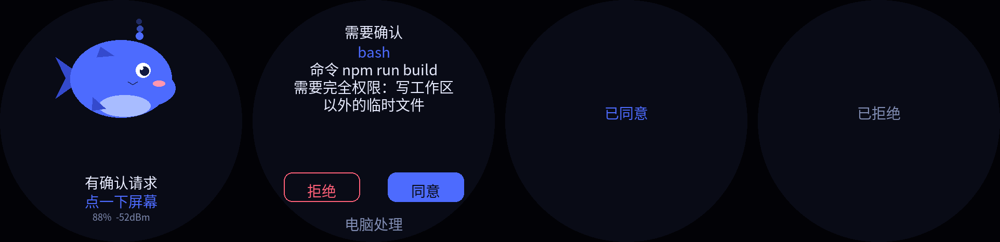

# dsh-ext

[DeepSeek Harness](https://github.com/deepseek-ai)（DSH）的外部扩展集合，以及配套的硬件固件。

| 目录 | 说明 |
| --- | --- |
| [`packages/stopwatch-bridge`](packages/stopwatch-bridge) | DSH Host 插件：把会话里的权限确认（approval）转发到 M5Stack StopWatch，手表上闪烁 + 大肥鱼动画 + 提示音，点屏幕即可批准/否决 |
| [`firmware/stopwatch`](firmware/stopwatch) | StopWatch 固件（Arduino / M5Unified），WiFi 连接、触摸 UI、鲸鱼动画、中文字模、音效与震动 |
| [`tools`](tools) | 工具链安装、字模/音效生成、WiFi 配置、编译烧写、假设备模拟器 |
| [`docs`](docs) | 方案与协议文档 |

## 屏幕预览（设计稿）



## 它能做什么

```
┌──────────────────────────────┐        WiFi / NDJSON         ┌───────────────────────────┐
│ DSH Host (macOS / Windows)   │  ◀────────────────────────▶  │ M5Stack StopWatch         │
│  stopwatch-bridge            │                              │  ESP32-S3 / 466×466 AMOLED│
│   ├ approval 抢占           │                              │   ├ 连接与心跳            │
│   ├ 设备服务 (TCP 47777)    │                              │   ├ 触摸 UI 状态机        │
│   └ 局域网发现 (UDP 47778)  │                              │   ├ 大肥鱼动画            │
└──────────────────────────────┘                              │   └ 喇叭 / 震动 / 亮度脉冲│
                                                              └───────────────────────────┘
```

1. 任意 DSH 会话里出现需要人工确认的操作时，手表立刻**闪烁 + 摇鱼 + 响一声 + 震动**；
2. 点一下屏幕，显示这次确认的关键信息（工具、命令、原因、第几个/共几个）；
3. 点「同意」或「拒绝」，结果立刻回到 DSH，会话继续；
4. 如果确认内容太复杂（超长、多段、被策略排除），手表直接显示「请到电脑上确认」，请求立刻交回 Web 界面；
5. 45 秒没在手表上作答，也会自动回落 Web 界面 —— 不会卡住会话。

## 快速开始

### 1. 安装插件（先在电脑上跑通，没有硬件也能用模拟器验证）

```bash
git clone https://github.com/odysliu/dsh-ext.git
cd dsh-ext
# 在 DSH 里用 plugin_manager 安装 packages/stopwatch-bridge，或：
#   直接把 packages/stopwatch-bridge 的绝对路径作为 install_bundle 的 target
```

配置项写在 profile 的 `cordis.patch.yml` 里（`id: stopwatch-bridge`）：

```yaml
- id: stopwatch-bridge
  name: '@dsh-ext/stopwatch-bridge'
  config:
    port: 47777
    mode: remote          # remote=手表可裁决；notify=只提醒
    timeoutMs: 45000
    token: ''             # 非空时设备必须带同一 token
```

### 2. 准备固件工具链

```bash
node tools/setup-toolchain.mjs     # 下载 arduino-cli + ESP32 core 3.3.4 + M5Unified（约 1.4 GB）
```

Windows 上用 PowerShell 执行同一条命令即可；脚本会按平台选择 `arduino-cli` 的发行包。首次下载体积较大且依赖 GitHub Releases，建议在网络稳定时执行；中断后重跑即可。

### 3. 配置 WiFi 并烧写

```bash
node tools/configure.mjs --ssid "你家WiFi" --password "密码"
node tools/flash.mjs --port /dev/cu.usbmodem1101     # Windows: --port COM5
```

设备上电后会自动在局域网里找到这台电脑（UDP 广播发现），屏幕进入待机。

### 4. 确认审批策略是 `ask`

手表只在**真的产生权限确认**时才会提醒。如果会话策略是 `never`（DSH 会直接拒绝、不弹确认），手表永远不会亮。在 Web 界面的权限设置里切回 `ask`，或使用 `/permission` 命令。

### 5. 没有硬件？先用模拟器

```bash
node tools/fake-device.mjs           # 模拟一块手表，自动接受/拒绝，可交互
```

## 当前进度

- ✅ Host 插件：approval 抢占、队列、超时/断线回落、25 个测试
- ✅ 假设备模拟器：无硬件即可验证完整确认流程
- ✅ 固件源码：连接、UI 状态机、鲸鱼动画、中文字模、音效、震动
- ✅ 固件编译验证（esp32 3.3.4，2.08 MB / 3 MB，0 警告）
- ⏳ 硬件联调：触摸校准、亮度、音量、功耗（等设备到货）

## 文档

- [方案与里程碑](docs/plan.md)
- [设备协议](docs/protocol.md)

## 许可

MIT
